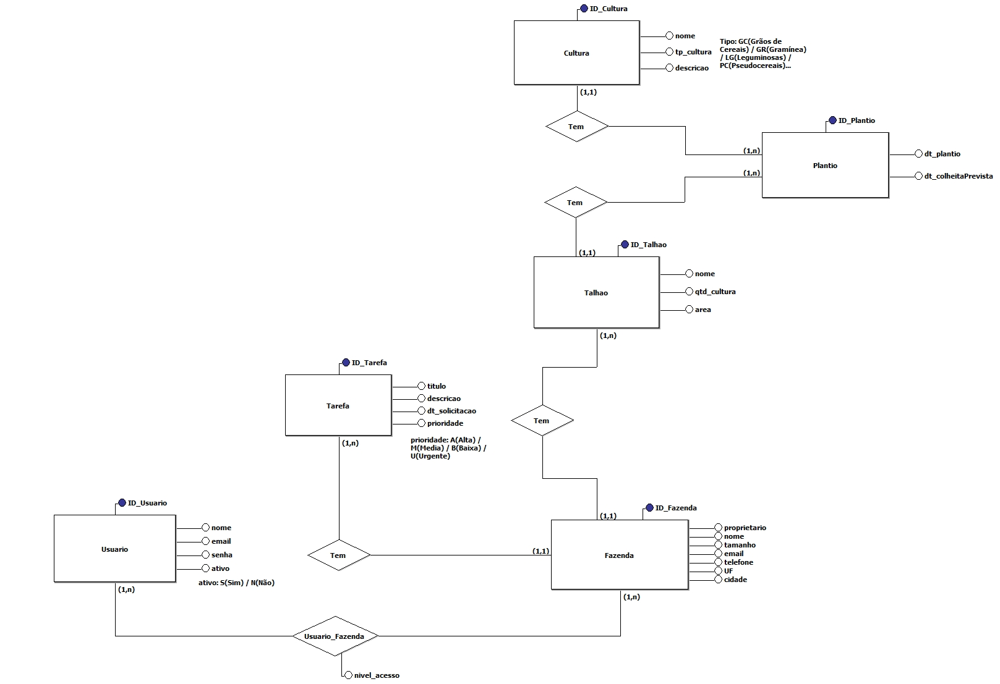

# 🌿 Emityma — Sistema de Gestão de Fazendas

**Emityma** é uma plataforma web para o gerenciamento de propriedades rurais. O nome vem do tupi antigo e significa "plantação" ou "coisa plantada", refletindo a conexão com a terra e a agricultura.

**Demonstração (somente leitura):** https://joaogalmeidas.github.io/Emityma/

> A demonstração no GitHub Pages é uma versão estática, com dados fictícios: não há login — em "Entrar", use **Abrir demonstração do painel** para navegar pelas três fazendas de exemplo como o usuário demo. Login, cadastro e qualquer alteração de dados exigem o servidor Django — veja [Executando localmente](#executando-localmente) (usuário `demo@emityma.local`, senha `emityma-demo`).

## 📌 Sobre o projeto

O objetivo do Emityma é oferecer uma solução integrada para produtores rurais, permitindo acompanhar as atividades da fazenda — do planejamento das culturas ao acompanhamento dos plantios e tarefas da equipe.

## ⚙️ Funcionalidades

- **Contas de usuário**: cadastro e login com senha armazenada como hash.
- **Fazendas**: cadastro de várias propriedades por usuário; quem cria a fazenda vira Administrador.
- **Usuários e permissões por fazenda**: níveis *Administrador*, *Gerente* e *Operador*.
- **Talhões**: cadastro, edição e exclusão das subdivisões da fazenda.
- **Culturas**: tipo, descrição e produtividade média (kg/ha).
- **Plantios**: cultura × talhão, com data de plantio e colheita prevista.
- **Tarefas**: organizadas por prioridade (Urgente, Alta, Média, Baixa).
- **Dashboard da fazenda** (ver abaixo): área em produção, produção prevista, próximas colheitas, situação dos talhões, tarefas e equipe.

### Estatísticas do dashboard

Todas calculadas a partir dos dados cadastrados (talhões, culturas, plantios, tarefas e usuários), em [`dashboard/services.py`](dashboard/services.py):

| Indicador | Como é calculado |
|---|---|
| **Área em produção** | Soma da área dos talhões com plantio em andamento, em relação à área total dos talhões; mostra também quanto da fazenda está dividido em talhões. |
| **Produção prevista** | Produtividade média da cultura (kg/ha) × área do talhão, somada para plantios em andamento e planejados, em toneladas. Os plantios já colhidos aparecem à parte como estimativa colhida. |
| **Plantios** | Quantidade em andamento, planejados e colhidos. |
| **Próxima colheita / Próximas colheitas** | Plantios em andamento ordenados pela colheita prevista, com dias restantes, % do ciclo já decorrido e produção estimada. |
| **Área em produção por cultura** | Gráfico de rosca com a participação de cada cultura na área em produção agora. |
| **Produção prevista por cultura** | Gráfico de barras + tabela com área, produção prevista e ciclo médio (dias entre plantio e colheita) de cada cultura. |
| **Situação dos talhões** | Em produção (cultura e colheita prevista), plantio planejado (cultura e data) ou livre (última colheita). |
| **Tarefas** | Distribuição por prioridade, tarefa aberta há mais tempo e tempo médio em aberto. |
| **Equipe** | Membros da fazenda por nível de acesso. |

Status de um plantio em relação à data atual: **planejado** (o plantio ainda não começou), **em andamento** (entre o plantio e a colheita prevista) e **colhido** (a colheita prevista já passou).

### Permissões

| Ação | Administrador | Gerente | Operador |
|---|:-:|:-:|:-:|
| Ver dashboard, tarefas, culturas e plantios | ✅ | ✅ | ✅ |
| Criar/editar/excluir tarefas, culturas e plantios | ✅ | ✅ | — |
| Ver usuários da fazenda | ✅ | ✅ | — |
| Editar fazenda, talhões e usuários (adicionar, mudar nível, remover) | ✅ | — | — |

## 🗂️ Modelo conceitual

Entidades principais: **Fazenda**, **Talhão**, **Cultura**, **Plantio**, **Tarefa**, **Usuário** e **UsuarioFazenda** (vínculo com nível de acesso).



## 🎨 Identidade visual


## 🚀 Tecnologias

- **Backend**: Python 3.13, Django 5.2 (LTS), SQLite
- **Frontend**: templates Django, Bootstrap (4 no painel — tema SB Admin 2; 5 na landing e no login), jQuery, Chart.js 2, Font Awesome, LineIcons
- **Publicação**: GitHub Actions + GitHub Pages (build estático gerado pelo próprio Django)

## Pré-requisitos

- Python 3.13 (versão usada no desenvolvimento e no CI)
- Git

## Executando localmente

```bash
git clone https://github.com/JoaoGAlmeidaS/Emityma.git
cd Emityma

python -m venv virtual
# Windows:  virtual\Scripts\activate
# Linux/macOS: source virtual/bin/activate

pip install -r requirements.txt
python manage.py migrate
python manage.py seed_demo      # opcional: cria dados de exemplo
python manage.py runserver
```

Acesse http://127.0.0.1:8000/ e entre com **demo@emityma.local** / **emityma-demo**.

### Dados de demonstração

O comando `seed_demo` cria dados **fictícios** (nomes, e-mails e números inventados) e pode ser executado novamente a qualquer momento: ele recria as fazendas de exemplo sem tocar em outros dados. As datas são relativas ao dia da execução, então sempre há plantios em andamento e já colhidos.

| Fazenda | Local | Usuário demo é | Conteúdo |
|---|---|---|---|
| Fazenda Demonstração | Sorriso/MT, 1.250 ha | Administrador | 6 talhões, 6 culturas (soja, milho, algodão…), 9 plantios, 9 tarefas |
| Sítio Boa Esperança | Lavras/MG, 48 ha | Gerente | pomar, bananal, horta e pastagem; 4 plantios, 3 tarefas |
| Fazenda Santa Clara | Rio Verde/GO, 620 ha | Operador | soja, milho safrinha e trigo; 5 plantios, 2 tarefas |

Assim é possível ver as diferenças de permissão entrando em cada fazenda. Contas de exemplo (todas com a senha `emityma-demo`): `demo@`, `ana.ribeiro@`, `carlos.mendes@`, `beatriz.souza@`, `rafael.lima@` e `juliana.costa@emityma.local`. Use essas contas apenas localmente.

Para começar com um banco contendo **somente** os dados de demonstração, apague (ou renomeie) o `db.sqlite3` e rode `python manage.py migrate` seguido de `python manage.py seed_demo`.

> O arquivo `db.sqlite3` não é versionado. Quem já tinha um banco local deve rodar `python manage.py migrate`: a migração `usuario.0003_hash_senhas` converte as senhas antigas (que estavam em texto puro) para hash, sem alterar o login.

### Variáveis de ambiente

| Variável | Padrão | Uso |
|---|---|---|
| `DJANGO_DEBUG` | `True` | Use `False` em produção. |
| `DJANGO_SECRET_KEY` | chave de desenvolvimento (somente com `DEBUG=True`) | **Obrigatória** quando `DJANGO_DEBUG=False`. |
| `DJANGO_ALLOWED_HOSTS` | `localhost,127.0.0.1` (em DEBUG) | Domínios aceitos, separados por vírgula. |

## Comandos

| Comando | O que faz |
|---|---|
| `python manage.py test` | Executa os testes automatizados. |
| `python manage.py check` | Verificações do Django. |
| `python manage.py makemigrations --check --dry-run` | Confere se há migrações pendentes. |
| `python manage.py seed_demo` | Cria/recria os dados de demonstração (idempotente). |
| `python manage.py build_pages --settings=emityma.settings_pages --output _site --base-path /Emityma/` | Gera o site estático do GitHub Pages em `_site/`. |

### Pré-visualizar o site estático

O caminho-base (`--base-path`) precisa coincidir com o endereço onde o site será servido. Para simular `https://usuario.github.io/Emityma/`:

```bash
python manage.py build_pages --settings=emityma.settings_pages --output preview/Emityma --base-path /Emityma/
python -m http.server 8080 --directory preview
# abra http://localhost:8080/Emityma/
```

> No Git Bash do Windows, prefixe o comando com `MSYS_NO_PATHCONV=1`; caso contrário, o shell converte `/Emityma/` em um caminho do Windows.

O `http.server` do Python não usa o `404.html`; essa página só é aplicada pelo GitHub Pages.

## Estrutura de diretórios

```
Emityma/
├── .github/workflows/pages.yml   # CI: testes + build + deploy no GitHub Pages
├── core/                         # Fazenda, Talhão, Cultura, Plantio, Tarefa
│   ├── access.py                 # login por sessão e controle de acesso por fazenda
│   ├── forms.py                  # validação dos formulários
│   └── management/commands/      # seed_demo e build_pages
├── dashboard/                    # views do painel e cálculo das métricas (services.py)
├── usuario/                      # modelo de usuário, cadastro, login e logout
├── emityma/
│   ├── settings.py               # configurações (lidas de variáveis de ambiente)
│   ├── settings_pages.py         # configurações do build estático (banco em memória)
│   └── static/                   # CSS, JS, imagens, fontes e bibliotecas
├── templates/                    # templates (landing, login, painel, 404)
├── manage.py
└── requirements.txt
```

## Publicação no GitHub Pages

### Publicar pela primeira vez

1. Envie as alterações para a branch `main`:
   ```bash
   git add -A
   git commit -m "Moderniza o projeto e publica a demonstração no GitHub Pages"
   git push origin main
   ```
   O `git add -A` também registra a remoção do `db.sqlite3`, dos `__pycache__` e da pasta `static/` gerada — os arquivos locais continuam no seu computador, apenas deixam de ser versionados (ver `.gitignore`).
2. No GitHub, abra **Settings → Pages** e, em **Build and deployment → Source**, selecione **GitHub Actions**.
3. Abra a aba **Actions** e acompanhe o workflow **Testes e GitHub Pages**. Se ele rodou antes do passo 2 e falhou no deploy, use **Re-run all jobs** (ou **Run workflow** para disparar manualmente).
4. Ao final, o link aparece no job **Deploy no GitHub Pages** e em **Settings → Pages**: https://joaogalmeidas.github.io/Emityma/

Não é necessário configurar segredos. A cada novo push na `main` o site é regerado — inclusive as datas dos dados de demonstração, que são relativas ao dia do build.

### Como funciona

O workflow [`.github/workflows/pages.yml`](.github/workflows/pages.yml):

1. instala Python 3.13 e as dependências de `requirements.txt`;
2. roda `check`, verifica migrações pendentes e executa os testes;
3. obtém o caminho-base do Pages (`actions/configure-pages`);
4. roda `build_pages`, que cria os dados de demonstração num banco em memória, renderiza as páginas com o próprio Django, copia os arquivos estáticos e **falha se algum link ou recurso local estiver quebrado**;
5. publica `_site/` com `actions/upload-pages-artifact` e `actions/deploy-pages`.

Em pull requests, o workflow roda testes e build, mas não publica.

### URL e caminho-base

- Repositório de projeto: `https://joaogalmeidas.github.io/Emityma/` → caminho-base `/Emityma/` (detectado automaticamente no CI).
- Domínio próprio ou repositório `usuario.github.io`: caminho-base `/` (também detectado automaticamente).

Todos os links e arquivos estáticos são gerados com `` e ``; não use caminhos absolutos escritos à mão (como `/entrar/`) nos templates, pois eles quebram quando o site é publicado num subdiretório.

## Limitações conhecidas

- **A versão do GitHub Pages é somente leitura.** Não há servidor: login, cadastro, formulários e a busca de usuários por e-mail ficam desativados e mostram um aviso. Para usar o sistema completo é preciso executar o Django — localmente ou num serviço que rode Python (por exemplo PythonAnywhere ou Render; nenhum está configurado neste repositório).
- **Colheita** ainda não foi implementada (a rota antiga apontava para um template inexistente e foi removida).
- O painel usa Bootstrap 4 e a landing/login usam Bootstrap 5; unificar exige revisar todos os templates.
- Imagens enviadas pelo usuário (`usuario_imagem`) não são usadas na interface.
- A `SECRET_KEY` que existia no código continua no histórico do git; qualquer implantação real deve definir uma nova em `DJANGO_SECRET_KEY`.
- Para produção, revise também os avisos de `python manage.py check --deploy` (HSTS e redirecionamento HTTPS dependem do serviço de hospedagem).
- A Google Fonts (Nunito) e o Bootstrap 5 da tela de login são carregados por CDN.
